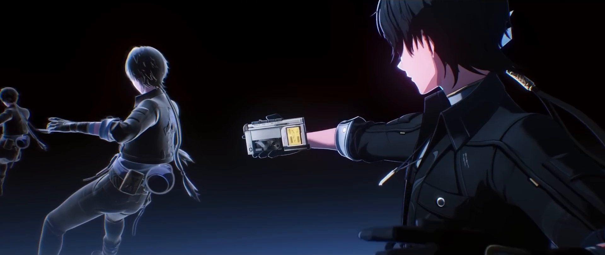
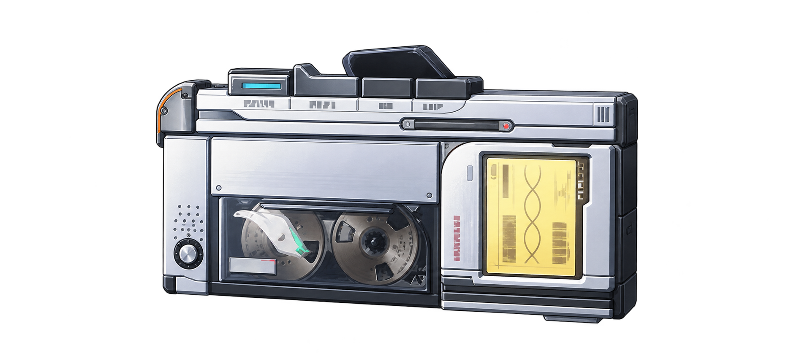

# Memory Tape · 같은 대상을 따라 기억 안으로

이 사례의 목표는 **한 장면 속 카세트를 알아보고 직접 살펴본 뒤, 관람에서 읽기로 이어지는 경험**이다. 디자이너에게는 구도·타이포그래피·읽기 시간·빛·조작권의 판단을, 개발자에게는 자료 정합·카메라·표시 상태·자산 예산·회복의 구현 이유를 함께 보여 준다.

[실제 예제](../memory.html)는 같은 host·scene·모델·캡처 프레임을 사용한다. [제작 사례 입구](../memory-making.html)도 같은 페이지를 연다. 독립 SVG/CSS 카세트나 가짜 decode 실험이 실제 renderer를 대신하지 않는다. 공통 기준은 [장면 설계 원리](CINEMATIC_PRINCIPLES.md), 새로운 내용의 판단 기록은 [DESIGN 템플릿](DESIGN_TEMPLATE.md)이다.

## 이 문서의 범위와 코드 읽기

이 문서는2026-10-23 공개 제작 사례를 위해 정리했다. 최초 이미지 재구성은2026-10-21, 모델 정합·카메라·캡처·비교는 그 뒤의 원 제작 기록이며, 현행 화면 QA와 별도로 표시한다. 기존 기록을 이 문서 작성 중의 새 측정으로 바꾸지 않는다.

| 현재 공개 표면 | 책임 |
|---|---|
| [memory.html](../memory.html)·[memory.css](../memory.css) | 실제 장면과 상세 제작 노트·원리·확인 범위·출처 |
| [memory-cinematic/overlay.js](../memory-cinematic/overlay.js) | Read/Watch 시계·modal·입력 반환·실제 링크·회복 |
| [memory-cinematic/entry-presentation.js](../memory-cinematic/entry-presentation.js) | 카메라·문장·마스크·빛의 각 시간과 완료 조건 |
| [memory-scene/viewer.js](../memory-scene/viewer.js)·[navigation.js](../memory-scene/navigation.js) | live GS+GLB·단일 카메라·현재 자세와 입력 |
| [memory-scene/image-viewer.js](../memory-scene/image-viewer.js) | Canvas2D·실제 표시 프레임·정규화 윤곽·decode 수명 |
| [memory-scene/assets.json](../memory-scene/assets.json) | 현재844개 역할·SHA·크기·모델/캡처/압축 provenance·공유 공간 track |

현행 화면은 제작 노트를 읽는 공개 예제다. Watch는 원래 방송 시점 연결에서 발전시킨 controller의 설계 사례이며, 이 페이지에 연결되지 않은 Watch 버튼이나 다른 이야기 본문을 제공한다고 약속하지 않는다. 현재 출하 runtime의 명시 검토 모드는 `?render=gaussian`과 `?render=images`다. `render=gaussian`은 소프트웨어 환경에서도 full3D를 강제하므로 CPU fallback 확인 주소가 아니다.

공개 미디어는 [PR #2](https://github.com/mizan0515/memory-tape/pull/2)의 merge commit `62b77884e5d390bcaf9914a6fda5791ee31adfad`에 고정한다. 원작의 초기 `47d73f5543e99834951b802d723cf0af93103c0e`는 출처 이력이며 현재 파생 자산의 revision과 다르다. 공개 코드·미디어의 반영, 실제 브라우저 QA, 새 콘텐츠에서의 이해는 각각 확인한다.
## 먼저 지켜야 했던 경험

어두운 넓은 장면 안에 인물과 카세트가 함께 있고, 사용자는 휠·드래그로 다가가며 현재 시점에서 다음 화면으로 들어간다. 처음부터 독립 카세트만 놓은 밝은 제품 소개로 바꾸면 원작의 기억·공간·입력 정체성이 사라진다. 이전 밝은 재해석은 이 이유로 채택하지 않았다.

큰 글자·프레임·빛은 장면 주변의 읽는 질서를 보강한다. 읽을 문장과 주 조작은 DOM에 두고 장식은 입력을 가로채지 않는다. 장면의 metadata를 읽는 overlay가 카메라에 값을 되써서 별도 driver가 되는 구조도 피한다.

이 장면을 이야기와 방송 시점으로 연결하는 적용에서는 기존 문장·장면 순서·정확한 인용·다시보기 시각을 유지하는 것이 연출보다 앞선 조건이었다. 현재 공개 페이지는 실제 장면과 제작 노트를 보여 주며 별도 이야기 본문을 복제하지 않는다.

## 원자료와 새로 만든 것의 경계

| 자료·표현 | 실제 출처와 한계 |
|---|---|
| 최초 Gaussian 장면 | 최초 제작에서 실제 프레임 한 장을 SHARP로 추론하고 SPZ로 압축한 `scene.spz`. 이후 장면 통합에서는 이 결과를 재사용했으며 새 Gaussian 추론을 실행하지 않았다 |
| 초기 카세트 근사 모델 | 생성 보완한 물체 이미지에서 TripoSR로 만든 초기 `cassette.glb`. 뒤쪽·두께는 추정이며 공식 게임 모델로 검증하지 않았다 |
| 현행 카세트의 별도 출발점 | 나중에 별도로 제공된 `aemeath_cassette.glb`를 정련했다. 초기 TripoSR GLB를 단순 압축한 모델과 계보가 다르며, 이 제공 파일의 생성 도구까지 확인한 것으로 서술하지 않는다 |
| 후면·옆면과 뒷판 | 생성한 색상 텍스처, 얇은 둥근 서비스 뒷판, 정비판·환기구·고무·금속 표현. 관측 사실이 아닌 창작 보완이다 |
| 점 제거 파생 SPZ | 원본 카세트에 해당하는 점을 선택적으로 제거한 별도 파일. 남은 점 속성과 원본 입력을 보존한다 |
| CPU 압축 이미지 | 승인한 같은 3D 장면을 오프라인에서 그린 파생물. 실시간 3D·신경망 보간·새 ML 재구성이 아니다 |

원작 미디어는 [고정 원본 커밋][upstream]에서 출처를 찾는다. 명조: 워더링 웨이브 시각 자료는 © KURO GAMES의 비공식 팬 실험이다. 현재 지정 공개 저장소로 발행하는 것은 최신 SPZ·GLB·842개 AVIF이며 다른 문서의 원문·수집 자료은 포함하지 않는다. 작은 실행 소스와 고지는 보존하고, 소비하는 키트는 큰 미디어를 다시 묶는 대신 이 공개 저장소의 고정 URL을 사용한다. 이 공개 발행을 게임 시각물 전체의 포괄 상업 라이선스로 설명하지 않는다.

## 이미지에서 Gaussian 장면과 카세트 모델을 만들기

아래는 보존된 원 제작 설명·실행 metadata·export 스크립트를 대조해 정리한 **최초 제작 기록**이다. 이번 공개 예제 정리에서 신경망 추론·설치·가중치 다운로드를 다시 실행한 결과가 아니다. 최초의 생성, 후속 모델 정련, 현행 브라우저 채택은 서로 다른 단계다. 현재 예제는 이미 저장된 SPZ·GLB·캡처 이미지를 읽으며 추론 서버를 호출하지 않는다.

### 여러 참조를 대조하되 SHARP에는 한 장을 넣었다

원 장면은 [공개 플레이 영상01:43:43](https://www.youtube.com/watch?v=AnTBwaQK9CU&t=6223s)의1920×1080 프레임이다. 사용자가 지정한 장면과 참조5장을 대조했지만 여러 시점의 사진을 정합해 공간을 삼각측량한 작업은 아니다. 검은 띠만 `(0,135)–(1920,945)`로 크롭한1920×810 이미지를 실제 SHARP 입력으로 썼다. 이 장면 입력에는 image generation·인페인팅·샤프닝을 적용하지 않았다.

*실제 추론 입력. 이미지 속 가려진 면까지 관측한 자료가 되지는 않는다.*

[Apple SHARP](https://github.com/apple-aiml-research/ml-sharp)는 사진 한 장에서3D Gaussian 표현을 예측하는 feedforward 모델이다. 이 사례의 출력은 XYZ 좌표만 나열한 점 집합보다 많은 속성을 갖는다. 각 Gaussian의 위치·SH0 색·불투명도·세 축 scale·quaternion 회전을 저장하고 renderer가 이 공간 표현을 다른 가까운 시점에서 그린다. 따라서 ‘포인트클라우드 생성’이라는 요약과 함께 **단일 이미지에서 추론한3D Gaussian 장면**이라고 설명해야 결과의 성격이 분명해진다.

| 최초 SHARP 실행 · 기록값 | 내용과 해석 |
|---|---|
| 코드·가중치 | 공식 코드 `aed6527499ef91cba3b54c18d49a870f25947190`, `sharp_2572gikvuh.pt` |
| 실행 조건 | 로컬 RTX4060 8GB·CUDA·공식 기본 float32. 모델 내부 입력1536×1536 |
| 초점 정보 | EXIF 초점 정보가 없어 공식 기본30mm 사용. 실측 카메라 보정값으로 간주하지 않음 |
| 시간 | 명령 전체38.196초, 로그의 신경망 구간20.799초. 이 사례의 장치 기록이며 upstream의 일반 속도와 구분 |
| PLY 결과 | 1,179,648개 Gaussian, 66,061,086bytes. 위치·색·opacity·scale·rotation을 파싱해 확인한 제작 기록 |
| 상호 교환 보정 | 공식 inverse-sigmoid 저장에서 alpha=1인6개 opacity만 `+Inf`가 됨. 호환용 사본에서 유한 logit16.11809555로 정규화하고 원본 PLY는 유지 |
| 유지한 값 | 그 정규화에서 위치·색·크기·회전·개수를 바꾸거나 점을 삭제하지 않음 |
| SPZ 압축 | Spark2.4.0 `transcodeSpz`, version3·fractionalBits16. 16,548,216bytes, PLY 대비74.95% 감소, clipping/filtering0개·Gaussian 수 동일 |

Gaussian 수가 같고 clipping이 없다는 기록은 압축이 무손실이라는 뜻이 아니다. SPZ의 표현·양자화와 파일 크기 감소를 구분한다. 또한 한 장에서 예측한 깊이·가려진 면은 실측 복원이 아니다. 가까운 시점의 입체감에는 유용하지만 넓은 회전에서 인물·손·뒤쪽이 늘어나거나 비어 보일 수 있다. 이 한계 때문에 카메라가 멀리 돌아갈수록 장면 전체를 고집하지 않고 카세트라는 식별 가능한 주역으로 인계했다.

### 카세트는 생성 보완 이미지에서 별도 mesh로 만들었다

손에 가려진 물체를 한 장면의 Gaussian만으로 크게 회전시키면 숨은 두께·뒷면이 충분하지 않다. 최초 제작에서는 사용자 허용 뒤 참조 이미지에서 내장 image generation으로 손·배경을 분리하고 가려진 작은 영역을 보완했다. 다음 이미지는 그 저장된 생성 입력이다. 원본 게임 프레임·실측 후면으로 소개하지 않는다.

*팬 재구성을 위한 생성 입력. 관측된 앞면의 인상과 생성·추정한 숨은 영역을 구분한다.*

[TripoSR 공식 코드](https://github.com/VAST-AI-Research/TripoSR)와 [공식 모델 카드](https://huggingface.co/stabilityai/TripoSR)를 사용한 원 실행 기록은 다음과 같다. 저장된 이미지를 입력으로 후속 단계를 다시 실행할 수 있는 구조와, 확률적 이미지 생성 자체의 픽셀 단위 재현은 다른 주장이다.

| 초기 카세트 실행 · 기록값 | 내용과 해석 |
|---|---|
| 코드·모델 | TripoSR `107cefdc244c39106fa830359024f6a2f1c78871`, `stabilityai/TripoSR/model.ckpt` |
| 추론 | RTX4060·CUDA·float32·chunk4096, 신경망2.595초 |
| 표면 추출 | marching-cubes 해상도192. Windows/Python3.12의 torchmcubes 호환 문제로 표면 추출만 scikit-image CPU 어댑터 사용; 학습 가중치·신경망·density를 바꾼 재학습 아님 |
| 환경 조정 | Transformers4.39.3. 원래 의존성의 Python3.12/Windows wheel 문제에 대한 제작 환경 선택 |
| mesh 결과 | 22,833정점·45,650삼각형, 전체8.719초, peakCUDA2,031,644,160bytes |
| 앞면 인상 보완 | 추론된 앞면에 생성 입력 이미지를 투영. raw mesh GLB914,148bytes에서 이 후처리를 거친 초기 GLB1,866,352bytes로 구분 |
| 사실의 한계 | 뒷면·두께는 생성 추정. 공식 추출 모델·측정한 실제 형상·원작 후면 복원의 증거가 아님 |

**초기 TripoSR 모델과 현행863,360bytes 모델은 계보가 다르다.** 이후 별도 제공된 `aemeath_cassette.glb`를 현재 모델의 출발점으로 받아 앞면·UV·고정 등록을 지키며 뒤·옆·서비스 뒷판과 재질 mesh를 정련했다. 현재 파일을 초기1,866,352bytes GLB의 단순 최적화 결과라고 연결하지 않는다. 제공 파일의 원래 생성 도구가 확인되지 않았다면 그 경계도 남긴다.

### 생성 기록을 공개할 때 남길 출처와 한계

SHARP의 [소스 라이선스](https://github.com/apple-aiml-research/ml-sharp/blob/aed6527499ef91cba3b54c18d49a870f25947190/LICENSE)와 [연구용 모델 라이선스](https://github.com/apple-aiml-research/ml-sharp/blob/aed6527499ef91cba3b54c18d49a870f25947190/LICENSE_MODEL)는 별도다. TripoSR의 코드·모델 MIT, Three·Spark MIT와 하나로 묶어 ‘전부 MIT’라고 설명하지 않는다. 가중치·전체 영상·가상환경은 현재 예제의 감상에 필요하지 않으며 이 공개 문서가 새로운 추론 재실행 kit를 제공한다는 뜻도 아니다. 게임 화면 권리와 생성 도구·모델의 조건 역시 소프트웨어 고지와 구분한다.

이 단계에서 다른 콘텐츠로 가져갈 것은 특정 모델명만이 아니다. **실제 입력을 보여 주기, 관측·생성·추정을 분리하기, 어떤 단계가 속성·형상·질감을 바꿨는지 기록하기, 출력과 후속 모델의 계보를 끊김 없이 표시하기, 재실행 기록과 현재 화면 확인을 구분하기**가 재사용할 기준이다. 이미 충분한 자산을 적용하는 단계에서는 같은 추론을 다시 실행한 것처럼 성과를 합치지 않는다.

## 카세트의 앞면을 움직이지 않고 모델을 보완한다

처음 모델의 뒤쪽 부품들은 서로 다른 깊이에 겹쳐 있었다. 후면에 평면 색상 지도를 붙이는 것만으로는 회전할 때 부품 경계가 갈라져 보였다. `refine_cassette.js`는 관측된 앞면 그림과 UV를 유지하고, 뒤를 하나의 얇은 둥근 판으로 정리한다. 옆면은 방향에 맞는 box projection, 뒤는 이웃 부품 사이에 이어지는 world-plane projection을 사용한다. [모델 제작 provenance][source-refine]

원본 82개 primitive는 재질별 다섯 mesh로 합친다. 결과는 뒷판을 포함해 약 4,500개 삼각형이며, 재질은 색·texture가 유지되는 unlit 표현이다. 이는 화면의 특정 기준에 맞춘 시각 모델 정리이지 재질의 물리 정확성이나 실제 제품 규격의 검증은 아니다.

보완한 후면이 bounds를 키워도 앞면 위치가 바뀌면 안 된다. 그래서 등록기는 모델을 매번 새 bounds에 끼워 맞추지 않고, 두 원자료 시점의 화면·덮개·손잡이 등을 보고 맞춘 고정 XYZ basis와 offset을 쓴다. 릴은 모델 안의 `ELIO_Reel_Anchor`에서 읽어 같은 월드 변환을 따른다. [고정 등록][source-registration]

GLB 압축은 형상·UV와 이미지 바이트를 구분한다. 문서상 출력은 2,343,280바이트에서 863,360바이트로 줄었고, 앞면 JPEG92·후면 JPEG85·작은 옆면 JPEG82를 사용했다. 앞면을 흰 배경에 합성한 것은 아니지만 PNG 바이트가 그대로라는 뜻도 아니다. 형상·UV bufferView 보존과 texture의 재인코딩을 각각 기록한다. [모델 품질·검수 범위][source-model]

기존 기록은 Khronos glTF Validator 오류·경고 0과 실제 Three 등록 테스트를 보고한다. 이 문서 작성 과정에서 GLB를 다시 생성하거나 그 검사 결과를 새로 얻지는 않았다. 원본과 고품질 이전 출력은 복구 근거로 남긴다.

## 사진 속 테이프와 모델의 이중 윤곽을 없앤다

초기 방식에서는 Gaussian 장면 속 테이프와 별도 mesh가 함께 있었다. 두 표현이 다른 깊이·형상을 가지면 회전 중 테이프가 휘어 보이거나 둘로 겹친다. alpha만 오래 교대시키는 방식은 그 중복을 길게 노출할 수 있다.

한 차례 개선은 **완성된 화면 전체의 상보 합성**이었다. Gaussian을 opacity 1로 target에 그리고, mesh를 불투명하게 화면에 그린 뒤 fullscreen quad로 `old × g + new × (1 − g)`를 만든다. 개별 splat의 alpha를 낮추는 것과 다르다. target은 로딩 때 할당·컴파일하고 혼합 구간이 끝나면 한 번의 월드 렌더로 돌아온다. 이것은 당시의 유효한 교대 해결책이며 최신 객체 구조와 구분해야 한다. [현재 합성 구현][source-design-blend]

현재 채택본은 한 단계 더 나아가 **처음부터 끝까지 같은 rigid 카세트 한 개를 유지**한다. 원본 SPZ에서 테이프 영역의 점 16,085개를 빼고 1,163,563개를 남겨, 모델이 사진 속 카세트와 중복되지 않게 했다. 인물·전경·주변 점은 유지하며 대상이 아닌 주변 공간만 물러난다. [현재 draw와 가시성][source-viewer-object]

점 제거 도구는 source-frame의 초점·좌표로 점 중심을 투영하고 depth·제거 polygon·보존 polygon을 적용한다. SPZ3/SH0의 선택한 row를 복사하고 header count만 바꾼다. 남은 점의 속성은 바이트 단위로 대조하며 원본 파일에 덮어쓰지 않는다. 이것은 수동 팬 장면 편집이며 모델 재학습이 아니다. [점 제거 provenance][source-cut]

비선형으로 구부린 케이스 초안은 폐기했다. 중복된 사진 속 테이프에 맞추려고 새 모델까지 비틀기보다 원본의 중복 표현을 제거하고 rigid 형상을 유지하는 편이 대상의 정체성을 지켰다. 제거 polygon과 보존 제외 영역도 해당 장면의 편집 값이며 다른 사진에 재사용할 자동 규칙은 아니다.

## 공간 경로와 들어오던 속도를 함께 다룬다

원작은 열 개의 자세 키를 채널별 PCHIP으로 연결한다. 이를 원래부터 두 키 베지어였다고 설명하지 않는다. 현재 공간 경로는 넓은 인물·카세트 시점과 근접 끝점의 두 자세를 사용하며 yaw·focus·reel·roll은 선형, 양의 radius는 로그 거리에서 보간한다. [두 자세 track][source-track]

두 키가 중요한 이유는 숫자를 줄여서가 아니다. 중간 방향 반전·후반부의 늦은 회전·과한 근접·들썩임을 따로 확인하고 읽을 수 있는 거리에서 회전이 보이도록 한정했기 때문이다. 이 방식은 pose 공간 보간이며 정확한 월드 좌표 베지어 곡선과 다르다.

휠·핀치 목표를 다시 정할 때는 analytic critically damped update로 현재 속도를 이어 간다. 직접 손으로 잡는 순간은 손에 맞춰 멈추는 의도된 경계다. idle의 작은 자동 회전과 사용자의 자유 회전도 별도로 더하며, 자동 범위를 줄인 것이 사용자의 관찰 각도 제한이 되지 않게 한다. [입력과 감쇠][source-navigation]

초기의 속도 인계 개선은 들어오던 진행·yaw 속도를 cubic의 첫 handle과 bridge에 반영하고, 기본 관람에서 좁은 옆면으로 끝나지 않도록 회전 예산을 고르는 접근을 썼다. 위치만 맞추고 속도가 달라지면 인계가 튄다는 문제를 다룬 역사다. 이 tangent·회전 예산이 최신 committed 재생에도 그대로 남아 있다고 설명하지 않는다.

최신 Read·replay는 **실제 현재 자세**에서 시작하되 idle의 각속도와 독립적으로 원래 film 방향으로 회전한다. yaw와 거리는 한 progress 곡선을 쓰며 별도 idle tangent·돌아가는 경로를 두지 않는다. 명시한 `endProgress`가 있으면 초기 진행 속도0에서 시작하고 목표에 이미 도착했어도 presentation의 duration을 유지한다. 목표가 없는 일반 재생은 접근 방향의 진행 속도만 이어받는다. pitch·focus·reel·roll은 시작값으로 고정한다. 현재의 위치·방향 인계와 의도된 속도 재설정을 구별하며 모든 축의 C1 연속성을 주장하지 않는다. [현재 재생 bridge][source-viewer-play]

최신 승인 standard 연출은 이 공간 경로를 사용하되 카메라가 p=.74에서 멈추고 host가 독서·빛·마스크를 계속 진행한다. 과거의 quiet 160ms·최대 .46초 자동 마무리나 더 깊은 끝점 기록이 현재 Read·Watch 시간표를 대체하지 않는다.

## 현재 자세에서 얻은 윤곽을 출입구로 쓴다

작은 저장 마스크를 확대하면 계단과 잘못된 자세가 드러났다. 고정 원형 입구도 회전한 카세트의 방향을 이어 주지 못했다. 최신 viewer는 모델의 outer hull을 한 번 만든 뒤 **현재 카메라에서 같은 형상을 매번 투영**해 host로 보낸다. [현재 투영][source-projection]

host는 convex outline을 둥근 SVG path로 만들어 core와 바깥 파동에 같이 쓴다. core는 카세트 부분을 먼저 열고, 더 넓은 페더는 주변을 걷으며, 주변 불투명도는 또 다른 시계로 줄어든다. blur 하나로 전체를 한꺼번에 희게 만드는 방식이 아니다. [벡터 마스크][source-transition]

Read에서는 전체 dialog를 열어 그 아래의 기존 본문을 드러낸다. Watch에서는 iframe 장면에만 마스크를 적용하고 검은 host와 문장을 남겨, 목적지로 가기 전에 본문이 잠깐 비치는 것을 막는다. 필수 인용·스트리머·시각은 마스크 밖에 두어 잘리지 않게 한다.

빛은 visible SVG에 직접 그린다. 현재 카세트 윤곽의 바깥 halo를 넓게 흐리고, 흐리지 않은 내부 cutout으로 표면을 보호한다. 먼 구도부터 윤곽을 보내야 opacity가 이미 오른 뒤 윤곽이 뒤늦게 도착해 빛이 갑자기 켜지는 일을 피할 수 있다. 일반 아이콘용 SVG 크기 규칙이 이 광원에 상속되지 않게 stage 크기도 명시한다.

이것은 실제 재질의 emissive나 물리 조명이 아니다. 다음 화면으로의 광학적 인계를 편집한 표현이다. 오목한 구멍·여러 부품의 관계가 중요한 모델에 convex 카세트 윤곽을 그대로 일반화하면 의미를 잃을 수 있다.

## 카메라 도착과 독서 완료를 같은 사건으로 묶지 않는다

아래는 **Memory의 선택된 standard 사례 값**이다. 다른 작품의 문장 길이·사용 과업·모션 설정에 그대로 쓰는 공용 기본값이 아니다. [시간 계획과 sampler][source-presentation]

| Read 클릭 뒤 | 역할 |
|---|---|
| 0–4.5초 | 현재 자세에서 p=.74까지 접근한 뒤 카메라 정지 |
| .1–.8초 | 현재 제목 opacity를 이어받아 물러남 |
| .55–1.25초, 이후 3.9초까지 | 현재 질문 상태에서 들어와 읽을 시간을 확보 |
| 2.95–5.2초 | 카세트 core가 먼저 열림 |
| 3.55–7.2초 / 3.75–6.9초 | 넓은 페더와 주변 불투명도가 겹쳐 진행 |
| 6.35초 | 충분히 드러난 본문의 modal·inert·scroll lock을 해제 |
| 6.9–7.8초 | 남은 입력 없는 veil만 사라지고 정리 |

초기 제목→질문의 수동 접근도 progress 범위로 정의해 앞뒤 스크롤에서 같은 상태로 돌아온다. Read는 클릭 당시의 제목·질문 opacity에서 이어받아 이미 보던 문장이 갑자기 바뀌지 않게 한다.

6.35초에 조작권을 반환한 뒤 남은 visual tail은 비모달·입력 불가 레이어다. 큰 blur와 scene은 그때 고정하고 약한 veil만 fade한다. 최종 정리가 사용자가 이미 움직인 본문의 scroll·focus를 다시 복구하지 않게 한다. [본문 조작권 반환][source-release]

Watch는 인용이 검증된 장면에만 인용 종류·문장을 쓴다. 화면 문구와 인물 대사를 구별하고, 인용이 없는 장면은 실제 카드·장면 제목을 인용부호 없이 사용한다. 문장 완전 표시 구간은 .42–3.45초로 약 3.03초다. [인용과 실제 링크의 인계][source-handoff]

halo는 1.4–3.45초에 먼저 밝아지고 **3.45초에 원래 시각의 새 탭을 요청**한다. 카메라는 4.7초까지 진행하고 core는 4.15초 이후 열린다. 링크 시각과 전환 종료는 다르다. 타이머와 rAF가 같은 pending link를 한 번만 소비하고, 요청이 늦어져도 그 뒤의 남은 전환을 보존한다. [현재 handoff][source-handoff]

새 탭이 배경에 열리면 남은 연출 후 본문으로 돌아오며, 원래 문서가 hidden이 되면 일찍 정리한다. 팝업이 막히면 실제 링크와 계속 읽기를 남기고 자동 복귀로 지우지 않는다. WindowProxy 반환이나 탭 존재는 YouTube 재생·포커스 성공을 보장하지 않는다.

## GPU와 CPU는 표현을 나누고 의미를 공유한다

최신 boot는 실제 WebGL renderer 문자열을 판별한다. 알려진 GPU는 전체 live Gaussian, 정보가 가려진 unknown은 중간 예산 live 경로, software 또는 WebGL 불가는 압축 이미지 플레이어를 선택한다. user agent나 WebGPU 존재만으로 가속을 단정하지 않는다. [선택 코드][source-boot] · [예산 분류][source-policy]

`render=gaussian`은 명시적 검토용 full live override다. 소프트웨어 장치에서도 3D를 강제하므로 이 URL의 성공을 CPU fallback 검증으로 쓰지 않는다. 내부 profile의 오래된 `prerender-video` 명칭과 달리 최신 boot의 자동 소프트웨어 경로는 `image-viewer.js`다.

초기의 사진 한 장·3D mesh 조합은 깊이와 원래 장면을 충분히 보존하지 못해 대체됐다. 이후 native video의 approach·idle도 비교한 중간 제작 방식이다. 현재 공개 runtime은 GPU와 압축 이미지 경로만 제공하고 film·capture 전용 화면은 출하하지 않는다. 이 역사를 현재 지원 옵션으로 안내하지 않는다.

## 승인된 장면을 그대로 오프라인 캡처한다

capture API는 같은 track·모델·주변 교대와 카메라를 사용한다. Gaussian LoD가 켜져 있으면 캡처를 거부하고 canvas와 source target을 모두 3414×1440으로 맞춘다. Spark의 현재 view sort/update가 끝난 뒤 실제로 그린 화면과 윤곽 metadata를 기록한다. [캡처 API][source-capture]

기존 기록에서 실제 Whale 5.39/RTX5070Ti로 **1,163,563개 전체 잔존 Gaussian·no LoD·native 두 버퍼**를 사용해 접근 181장과 idle 240장을 만들었다. 캡처 UI는 렌더러 증거를 확인하며 결과물만 내보내는 비공개 authoring 입구다. 브라우저 프로필·인증 상태가 이 자료에 포함되는 경로가 아니다. [캡처 관련 구현][source-capture-ui]

접근 181장은 공간 progress의 균등 표본이며 시간의 181프레임 영상과 다르다. 가속·Read·Watch 시간은 host와 track에서 정한다. idle 240장은 16초 loop이므로 서로 다른 이미지 **15장/초**다. pitch는 yaw와 같은 주기로 맞춰 seam을 줄였으며 live 경로의 결합 주기까지 그대로 재현한다고 주장하지 않는다.

rAF가 60번 호출돼도 같은 이미지가 반복 표시되면 60개의 새 이미지가 아니다. NVIDIA 60fps 보간은 조사만 했고 이 후보에 도입하지 않았다. 이 이미지 재생을 neural interpolation이나 60fps 달성으로 소개하지 않는다.

## 압축은 더 작은 파일과 남은 손실을 함께 기록한다

GPU draw에서 WebP Q90과 Q80을 직접 캡처했다. 직접 Q80 전체 421장은 37,673,116바이트였고, 최종 AVIF Q50/speed6은 보존한 Q90에서 만들었다. **Q90도 이미 손실 압축된 입력**이다. 무손실 scene master에서 바로 만든 AVIF라고 설명하면 사실과 다르다. 코덱 사이의 50·80·90도 같은 품질 척도가 아니다. [압축 provenance][source-compression]

1080 버전은 기존 AVIF를 다시 줄인 것이 아니라 같은 Q90 입력에서 LANCZOS로 2560×1080 파생을 만들고 AVIF50으로 인코딩했다. 자세·radius·정규화 윤곽을 유지하며 asset key만 별도 namespace로 둔다.

| 선택 파생물 | 전체 421장 | 초기 접근+idle 4장 | 선택 조건 |
|---|---:|---:|---|
| 3414×1440 AVIF50 | 21,251,044바이트 | 9,595,773바이트 | 최초 실제 letterbox 높이×DPR이 1080 초과 |
| 2560×1080 AVIF50 | 14,881,465바이트 | 6,517,908바이트 | 최초 실제 letterbox 높이×DPR이 1080 이하 |

같은 페이지가 열린 동안 받은 버전을 유지한다. 창이 커지거나 작아졌다고 반대 버전까지 받지 않으며 현재 viewport에 맞춘 decoded surface만 다시 만든다. 더 큰 버전으로 재다운로드하지 않는 선택은 이 과업의 네트워크·반복 조작 비용에 맞춘 판단이다. 확대 감상이 핵심인 다른 제품에는 다시 판단해야 한다.

채택 전에는 native 대표 12장을 비교했고, 최종 842개 파생물의 독립 decode·치수·해시를 확인했다는 기록이 있다. software Chrome의 1280×540 두 회차 median decode는 AVIF50 26.2ms, WebP80 26.5ms였으며 p95는 34.0/31.8ms였다. 이것은 작은 표본의 decode 비교이며 전체 재생·모든 장치·무손실·60fps의 증거가 아니다. [품질 검토의 정확한 범위][source-image-evidence]

## 압축 보관과 decoded 픽셀의 수명을 나눈다

압축 Blob cache는 64MiB와 fetch 동시 2개, decoded bitmap cache는 최대 4장과 decoder 1개다. 현재 보일 목표를 우선하고 미래 표본 한 장만 lookahead로 준비한다. 많은 고해상도 이미지를 모두 `Image`로 만들어 decoded 상태에 두는 preload는 사용하지 않는다. [두 캐시][source-sequence]

초기에는 접근 이미지 전체와 idle 첫 4장의 **압축 바이트**를 준비한다. 나머지 idle은 뒤에서 준비한다. 실제로 표시할 몇 장만 viewport 크기에 맞춰 decode하고 LRU 퇴거·resize·dispose에서 `ImageBitmap.close()`로 해제한다. reset·되감기·Read·Watch·재열기에서는 같은 Blob을 쓴다.

입력 목표·decode 요청·painted frame은 다른 상태다. 역방향이나 resize 후 늦게 도착한 옛 요청이 현재 화면을 다시 덮지 않게 epoch와 최신 목표를 확인한다. decoder는 동시에 여러 개를 열지 않고 현재 목표가 speculative preload보다 앞서도록 한다.

**진행·반경·윤곽은 실제 그린 프레임에서만 publish한다.** 예정 progress가 먼저 이동해 마스크가 아직 보이지 않는 카세트에 붙는 일을 막는다. 캡처 윤곽은 viewport 정규화 좌표이며 현재 letterbox에 한 번만 대응시킨다. [표시 상태와 윤곽][source-image-player]

software 이미지는 스크롤·세로 쓸기·키보드 접근을 지원하며 자유 3D 회전은 제공하지 않는다. 안내도 그 차이에 맞춘다. 같은 문장·정확한 목적지·Read/Watch 마스크·취소·본문 복귀를 공유한다고 모든 조작이 같다고 말하지 않는다.

기존 브라우저 기록에서는 반복 조작과 1080→큰 창·1440→모바일 폭 변경 후에도 image fetch 421회가 늘지 않았다. 이는 페이지 수명의 재사용이며 새로고침 이후 영구 오프라인 보관을 보장하는 기능이 아니다. [재사용 확인][source-image-evidence]

## 첫 사진과 실제 첫 자세와 idle을 따로 준비한다

controller ESM을 기다리는 동안 흰 본문이 잠깐 보이던 문제는 critical CSS와 작은 classic script로 첫 페인트부터 어두운 제목·로딩 상태를 보이게 했다. controller가 실제 dialog를 연 뒤 cover를 해제하며, 실패·45초 무응답에서는 읽기로 복구한다. 늦게 도착한 controller가 다시 intro를 덮지 않게 기존 방문 상태를 사용한다. [startup 교정][source-startup]

로딩 사진은 이미 만들어 둔 최종 접근 첫 AVIF를 재사용한다. scene은 `entry=poster`에서 p0/radius 1.40779/yaw0/pitch0를 실제로 그린 뒤 inactive로 준비한다. 사진 decode와 scene ready를 모두 확인한 후 activate하고 450ms 동안 사진만 걷는다. 로딩 동안 orbit 시계를 먼저 돌려 어긋난 자세가 튀어나오는 일을 막는다.

Read의 명시 입력은 poster 대기를 끝내고 active→play 순서를 보장한다. 장면 hash·본문 방문 history·뒤로가기는 기존 읽는 위치로 직접 진입한다. 제목도 처음 HTML부터 standard 전환 속성을 선언해 controller 준비 전후 배치가 달라지지 않게 했다. [현재 첫 자세와 조작권][source-release]

## 도움말과 회복은 실제 행동을 따른다

GPU의 드래그 회전·휠 접근과 이미지의 세로 쓸기는 같은 안내로 대신하지 않는다. 모바일에는 해당 조작 chip을 남기고 desktop은 실제 입력 뒤 안내를 접어도 되돌릴 수 있게 한다. 사용자가 고른 시점·인용·읽는 위치를 도움말 열기나 닫기가 초기화하지 않는다.

3D 모듈·source·decode 실패에는 고정된 읽을 수 있는 오류와 본문 경로를 제공한다. remote exception URL을 그대로 독자 문구에 넣지 않는다. pending 영상이 있으면 실제 링크 fallback을 보존한다. 확인되지 않은 모바일 터치나 새 탭 autoplay는 성공한 것처럼 안내하지 않는다.

Act5의 전체 모션·관람 정책은 이 장면에 맞춘 선택이다. 이를 모든 CVA 페이지의 OS 감소 모션 무시·상시 자동재생 기본값으로 옮기지 않는다. 이전 넓은 자동회전·별도 중지 버튼은 역사이며 현재 template의 API로 약속하지 않는다. 현재 공개 예제는 감소 모션 설정에서 본문부터 열고 명시적으로 장면을 다시 볼 수 있게 한다. GPU 자유 회전과 CPU 이미지의 조작 차이, 읽기·취소·실패·본문 복귀는 현재 host에서 확인한다.

## 미디어와 공개 전달

현재 미디어는 이 공개 저장소의 commit `62b77884e5d390bcaf9914a6fda5791ee31adfad`에 고정한다. 경로는 `media/memory-tape/<sha256>/<filename>`이며 [assets.js](../memory-scene/assets.js)가 [역할별 manifest](../memory-scene/assets.json)의 SHA·파일명으로 정확한 자산을 찾는다. 소스와 페이지를 수정하는 일, 같은 미디어 바이트를 제공하는 일, 실제 브라우저에서 읽히는 일을 구분한다.

| 공개 대상 | 파일 수 | 바이트 |
|---|---:|---:|
| 카세트 점을 제거한 SPZ | 1 | 16,263,649 |
| 보완·압축한 rigid GLB | 1 | 863,360 |
| 3414×1440 AVIF | 421 | 21,251,044 |
| 2560×1080 AVIF | 421 | 14,881,465 |
| 합계 | 844 | 53,259,518 |

최신 실행에 필요하지 않은 과거 WebP·기각 모델·MP4는 이 844개 목록에 넣지 않았다. 과거 별도 asset gateway도 검토했지만 현재 공개 runtime은 고정 GitHub URL을 사용한다. Origin/Referer 기반 hotlink 제한과 CORS는 사용자 인증·DRM이 아니며 받은 사람의 바이트 보관을 막는다고 설명하지 않는다.

공개 자산의 대표 GET·SHA256·CORS 확인은 전달 검증이다. 과거 캡처의 GPU 품질·무손실 여부·새 브라우저의 전체 과업 성공을 대신하지 않는다. 원격 자산과 Three/Spark 공식 CDN을 읽으므로 인터넷이 필요하고 실패하면 읽기로 복귀할 수 있어야 한다.

명조: 워더링 웨이브 시각 자료 © KURO GAMES. 비공식 팬 시각 실험이다. [자산 출처](../memory-scene/SOURCE-ATTRIBUTION.txt)와 [소프트웨어 고지](../memory-scene/THIRD_PARTY_NOTICES.txt)를 유지한다. Three·Spark의 MIT 고지는 라이브러리 소프트웨어에 적용하며 게임 시각물 전체의 포괄 상업 라이선스가 아니다.
## 선택과 폐기 과정을 시간순으로 읽기

| 단계 | 문제와 선택 | 현재 남긴 교훈 |
|---|---|---|
| 최초 이미지 재구성 | 장면 crop→SHARP→PLY 정규화→SPZ, 생성 보완 물체 이미지→TripoSR→초기 GLB | 단일 이미지 추론·생성 보완·가려진 면의 한계를 구분하고 실제 입력과 출력 계보를 남김 |
| 원작의 맥락 보존 | 밝은 제품 소개 재해석은 어두운 전체 장면의 기억·공간을 잃어 폐기 | 색과 카드만 바꾸는 재해석보다 주역·입력 정체성을 먼저 확인 |
| 초기 장면 연결 | 기존 글·순서·인용·시간을 유지하고 장면을 별도 적용 | 국소 시각 변경이 자료의 의미·목적지를 바꾸지 않게 함 |
| 강제 읽기 구간 | 고정2.8초 읽기+1.8초 마무리는 스크롤을 빼앗는 느낌으로 폐기 | 읽기 시간과 조작권·시각적 마무리를 분리 |
| 과한 근접 | 카세트가 크게 차기 전에 fade 경계를 앞당기며 비교 | 경계 숫자만 늘리기보다 경로·대상 정합을 함께 검토 |
| 카메라 정리 | 두 자세·로그 거리·감쇠·속도 인계를 검토 | 키 수·테스트 개수를 연출 품질로 대신하지 않음 |
| full-frame 교대 | splat별 alpha 대신 완성된 화면을 상보 합성 | 표현 중복과 합성 순서를 구분 |
| 초기 가속 불가 표현 | 사진 한 장·mesh, 저해상도 film·seek를 비교 | 깊이 근사·품질·조작 범위의 한계 확인. 현재 기본은 압축 이미지 |
| 모델과 장면 정합 | 뒷면 보완·고정 등록·다섯 mesh. 구부린 케이스 폐기 후 원래 테이프 점 제거 | 처음부터 같은 rigid 카세트 한 개를 유지 |
| standard/inverse 비교 | 사용자가 standard를 선택 | 개인 선호를 보편적 성능 순위로 일반화하지 않음. 현재 예제는 standard 중심 |
| 독립 presentation | Read7.8초·본문6.35초·Watch3.45초 요청과 외부 halo | camera 종료와 독서·행동 완료를 분리한 사례 값 |
| 압축 이미지·첫 자세 | native GPU 캡처→AVIF, 1080/1440 선택·캐시·painted ID·poster·조작권 | 의미·표시·자산 수명·회복을 각각 설계 |
| 실제 제작 사례 공개 | 설명용 모형을 주 화면으로 두지 않고 같은 engine·모델·실제 프레임으로 상세 설명 | source·기존 제작 기록·현행 브라우저 QA를 구분 |
## 무엇을 확인했고 무엇이 남았는가

아래 표에서 원 제작 기록과 현재 공개 예제의 QA를 구분한다. 문서가 재구성됐다는 사실로 과거 측정을 새로 얻었다고 해석하지 않는다. 소스·파일 무결성·실제 브라우저·사용자 이해는 서로 다른 주장에 답한다.

| 주장·영역 | 기록된 근거 | 남은 한계 |
|---|---|---|
| 기존 내용과 목적지 보존 · 원 제작 기록 | 문장·장면 순서·원래 인용·다시보기 시각의 대응 | 현재 공개 제작 노트가 그 원래 본문을 제공한다는 뜻이 아님 |
| 최초 재구성 · 원 제작 기록 | 보존된 SHARP/TripoSR 실행 metadata·export·압축 기록과 실제 입력 | 이번 공개 채택에서 추론·새 환경 설치를 재실행한 결과가 아님. 초기 TripoSR와 현행 제공 모델의 계보 구분 |
| rigid 모델·정합·점 보존 | glTF 검수, 실제 Three 등록 회귀, SPZ 잔존 row 바이트 대조 | 공식 게임 모델·보이지 않던 면의 정확성은 미검증 |
| 마스크·halo·Read/Watch | IAB RTX5070Ti desktop 및 390×844 조작·캡처와 상태 기록 | 실제 iPhone·모든 GPU·YouTube autoplay 보장은 아님 |
| 이미지 품질·무결성 | 대표 native 12장 비교, 최종 842장 독립 decode·해시·치수 | 무손실·60fps·모든 콘텐츠 품질의 인증이 아님 |
| software 재생·재사용 | 실제 Chrome Basic Render Driver, Whale, IAB 반응형; 421 fetch 유지 | 장치·폭·전경 상태를 넘어 일반화하지 않음. 원격 자산의 cold-load 벤치마크 아님 |
| 첫 화면·controller 지연 | 5초 지연 전후·오류 복구, 제목 2초 지연 좌표 확인 | 모든 네트워크·브라우저에서 무지연이라는 뜻이 아님 |
| 이해와 사용 가치 | 사용자 비교·수정 요청과 실제 정상 과업의 관찰 | 처음 보는 사람 대상의 정량 사용자 연구는 미검증 |
| 공개 전달 · 현행 채택 기록 | 844개 파일 manifest·고정 raw commit·대표 GET/hash/CORS·공개 예제 | 모든 네트워크의 성능·전체 라이선스·사용자 이해의 인증이 아님 |

원 제작 기록에는 이미지 cache·renderer 선택·카세트 투영/등록·presentation·startup·점 속성 보존 등의 회귀가 있다. 검사 개수는 당시 코드의 범위이며 현재 브라우저나 사용자 이해의 점수가 아니다. 현재 공개 예제의 [확인 범위](../memory.html#verification)는 live/강제 이미지 로딩·접근/역방향·Read/Escape/본문·재열기·390px viewport·고정 자산 전달을 구분해 기록한다. 이 문서 정리 과정에서 해당 모든 장치 시험을 다시 수행한 것은 아니다.

## 다른 작품에서 가져갈 것

다른 콘텐츠에서 가져갈 것은 카세트·청록색·초 단위 시간표 자체가 아니다. **관측·추정을 구분하고 같은 대상을 유지하는 기준, 현재 보이는 표현에 맞춘 상태·윤곽, 독서와 실제 인계의 시간, 조작권·자산 수명을 명확히 나누는 방법**이다.

제품 소개는 앞면·부품을, 유물 설명은 실측면·보완면을, 지도는 장소 ID·현재 필터를, 데이터 화면은 단위·근거를 대응시킬 수 있다. 목록·즉시 계산·반복 관리자 작업처럼 전환보다 빠른 비교가 중요한 과업에는 이 영화식 연출을 생략한다. 적용 조건·반례·대표 과업을 [DESIGN 템플릿](DESIGN_TEMPLATE.md)에 해당하는 만큼만 남긴다.

## 현재 코드와 출처

원작 프로젝트는 [mizan0515/memory-tape](https://github.com/mizan0515/memory-tape)이며 원자료 프레임은 [공개 플레이 영상01:43:43](https://www.youtube.com/watch?v=AnTBwaQK9CU&t=6223s)이다. 라이브러리는 Three.js0.180.0·Spark2.4.0의 고정 공식 CDN을 사용한다. 원래 미디어와 파생 provenance·고지를 함께 읽는다.

[source-refine]: ../memory-scene/assets.json
[source-registration]: ../memory-scene/cassette-registration.js
[source-model]: ../memory-scene/assets.json
[source-design-blend]: ../memory-scene/viewer.js
[source-viewer-object]: ../memory-scene/viewer.js
[source-cut]: ../memory-scene/assets.json
[source-track]: ../memory-scene/motion-track.js
[source-navigation]: ../memory-scene/navigation.js
[source-viewer-play]: ../memory-scene/viewer.js
[source-projection]: ../memory-scene/viewer.js
[source-transition]: ../memory-cinematic/cassette-transition.js
[source-presentation]: ../memory-cinematic/entry-presentation.js
[source-release]: ../memory-cinematic/overlay.js
[source-handoff]: ../memory-cinematic/overlay.js
[source-boot]: ../memory-scene/boot.js
[source-policy]: ../memory-scene/render-policy.js
[source-capture]: ../memory-scene/viewer.js
[source-capture-ui]: ../memory-scene/viewer.js
[source-compression]: ../memory-scene/assets.json
[source-image-evidence]: ../memory-scene/assets.json
[source-sequence]: ../memory-scene/image-sequence.js
[source-image-player]: ../memory-scene/image-viewer.js
[source-startup]: ../memory-cinematic/startup.js
[upstream]: https://github.com/mizan0515/memory-tape/tree/47d73f5543e99834951b802d723cf0af93103c0e
